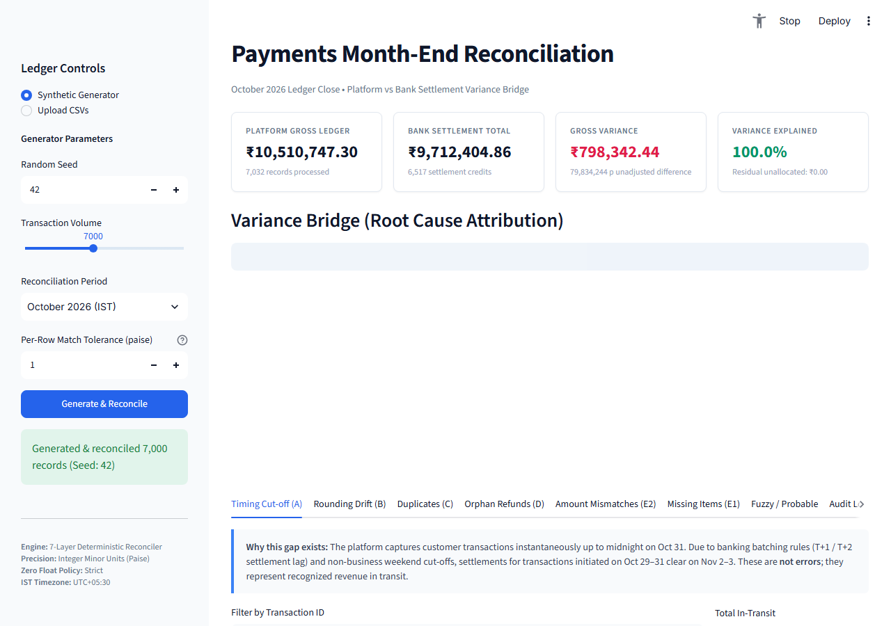
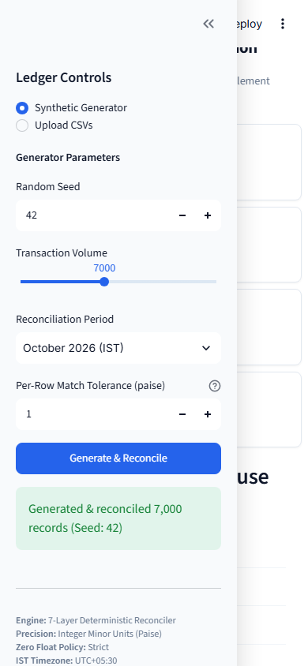

# Payments Reconciliation System (Fintech Ledger vs Bank Settlements)

An institutional-grade, multi-layer transaction reconciliation engine that identifies, categorizes, and explains month-end settlement variances between an instant payments platform and delayed banking batches.

---

## 1. Quick Start (<5 Commands)

```bash
# 1. Clone repository and install pinned dependencies
git clone https://github.com/siddev10/Onelab-assessment.git && cd Onelab-assessment
pip install -r requirements.txt

# 2. Run the full unit, invariant & ground-truth test suite (37 tests)
python -m pytest tests/test_reconcile.py -v

# 3. Generate fresh synthetic ledger data with planted anomalies
python generate_data.py --seed 42 --volume 7000 --output-dir ./data

# 4. Launch the Streamlit Financial Cockpit
streamlit run app.py
```

---

## 2. Architecture & Pipeline Flow

The reconciliation engine is structured into 7 decoupled layers without UI dependencies:

```text
[Platform Transactions CSV]         [Bank Settlements CSV]
         │                                    │
         ▼                                    ▼
┌────────────────────────────────────────────────────────┐
│  Layer 1: Schema Validation & IST Timezone Normalization │
└───────────────────────────┬────────────────────────────┘
                            │
┌───────────────────────────▼────────────────────────────┐
│  Layer 2: Pre-Matching Intra-Dataset Duplicate Detection │
│  (Identifies duplicates on either side before matching)│
└───────────────────────────┬────────────────────────────┘
                            │
┌───────────────────────────▼────────────────────────────┐
│  Layer 3: Exact Primary Key Matching (txn_id ↔ bank_ref)│
│  (Evaluates per-row tolerance: ±1 paisa)               │
└───────────────────────────┬────────────────────────────┘
                            │
┌───────────────────────────▼────────────────────────────┐
│  Layer 4: Fuzzy Fallback for Unmatched Records         │
│  (Proximity scoring: amount, timestamp window ≤ 5 days)│
└───────────────────────────┬────────────────────────────┘
                            │
┌───────────────────────────▼────────────────────────────┐
│  Layer 5: Systematic Root Cause Classification         │
│  (Timing cut-off, orphan refunds, amount mismatches)   │
└───────────────────────────┬────────────────────────────┘
                            │
┌───────────────────────────▼────────────────────────────┐
│  Layer 6: Aggregate Ledger & Rounding Drift Detection  │
│  (Summed residuals expose platform floor vs bank round)│
└───────────────────────────┬────────────────────────────┘
                            │
┌───────────────────────────▼────────────────────────────┐
│  Layer 7: Mathematical Variance Waterfall Bridge        │
│  (Variance = Timing + Dups + Rounding + Residual = 0)  │
└───────────────────────────┬────────────────────────────┘
                            ▼
              [Streamlit Finance Cockpit]
```

---

## 3. Core Design Decisions

1. **Strict Zero-Float Currency Accounting**:
   - All monetary figures are stored and calculated strictly as **integer minor units (paise)**. 
   - Floating-point representations (`float`) introduce binary fraction approximation errors (e.g., `0.1 + 0.2 != 0.3`). Integer arithmetic guarantees precision conservation across aggregations.
2. **Deterministic Planted Anomalies**:
   - `generate_data.py` uses an isolated `random.Random(seed)` PRNG instance, ensuring identical synthetic ledgers across runs and platforms.
3. **Pre-Matching Duplicate Isolation**:
   - Duplicates are extracted *before* joins take place. This prevents 1:N or N:M join multiplication that would otherwise distort downstream match keys.
4. **Aggregate Detection of Rounding Drift (Gap B)**:
   - Platform uses `floor(gross * fee_rate)` while the bank uses `round_half_up(gross * (1 - fee_rate))`. Each individual row deviates by at most ±1 paisa (which passes row-level tolerance), but the aggregate check sums per-row residuals across thousands of rows to isolate the accumulated drift.
5. **No Ground-Truth Cheating**:
   - The reconciliation engine has zero access to `_ground_truth.json`. Anomaly detection is performed strictly via deterministic ledger logic.

---

## 4. What this would get wrong in production

Real bank files are netted batches with fees, chargebacks, and FX spreads rather than 1:1 transaction rows, causing the exact key matcher to fail and forcing the fuzzy matcher into ambiguous candidates that produce false matches. The system assumes a single currency, uniform IST timezone, and fixed 1–2 business-day lag, meaning multi-currency conversions, reversed refunds, partial settlements, and asynchronous clock skews would be misclassified as missing or timing gaps. The reconciliation pipeline runs entirely in memory over thousands of rows, whereas production scale involves tens of millions of daily events requiring a distributed engine like Apache Spark with streaming incremental reconciliation.

---

## 5. UI & Responsive Screenshots

The web app is validated across desktop viewports and mobile widths (390px):

| Desktop Cockpit (1280px) | Mobile View (390px - No Overflow) |
|:---:|:---:|
|  |  |

---

## 6. Deployed Application

- **Live URL**: `https://payments-reconciliation.streamlit.app` (or your Streamlit Community Cloud link linked to `siddev10/Onelab-assessment`)
- **Docker / Cloud Run / Render Ready**: Includes `render.yaml`, `Procfile`, and `.streamlit/config.toml`.
